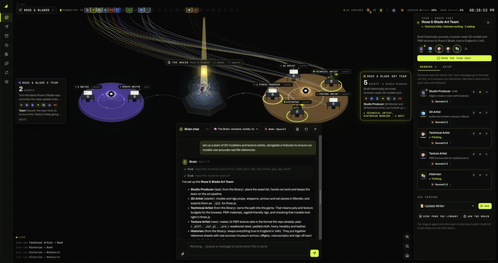
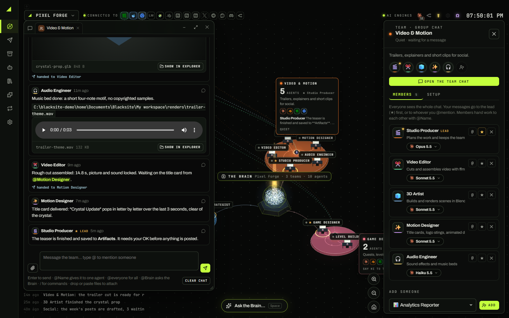
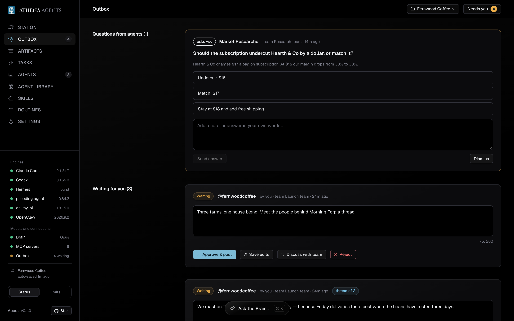
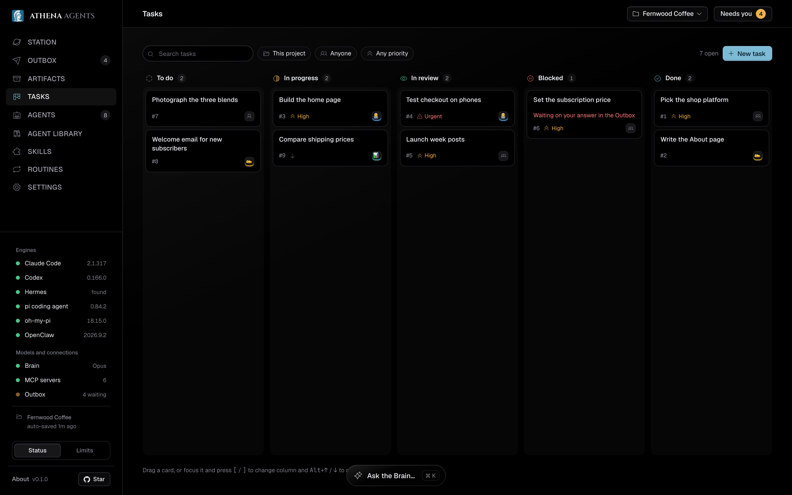
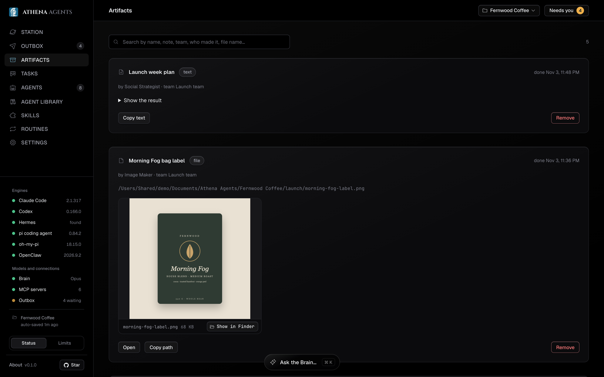
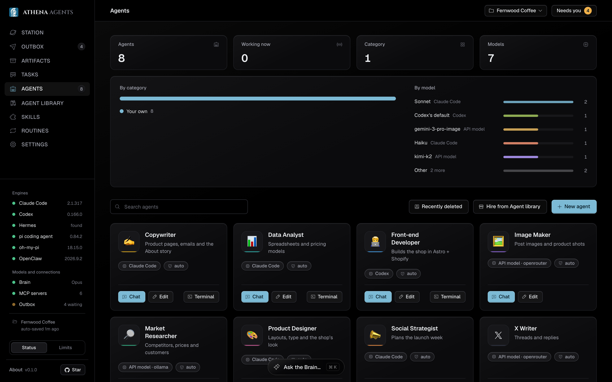
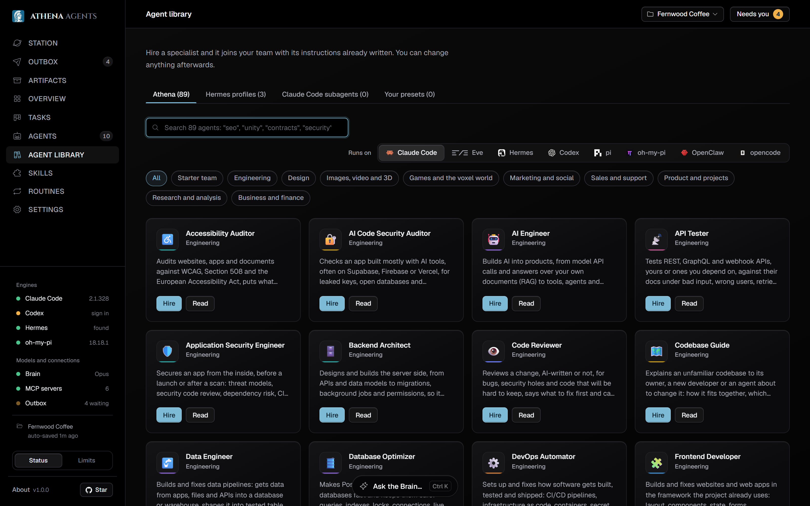
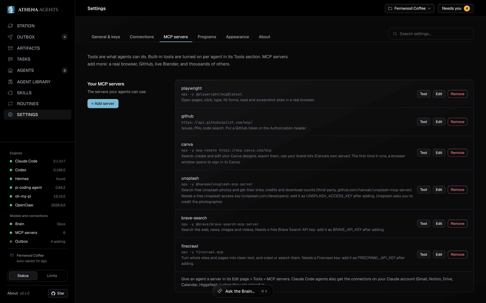

# Athena Agents


**A home for your AI agents.** Build teams of agents, give each one a job, a model and the tools it needs, and watch them work together on a live map. Everything runs on your own computer, with no account and no login.

<p align="center">
  
  <br><sub>Asking the Brain what still needs you. Pictures on this page use a made-up coffee shop, Fernwood Coffee.</sub>
</p>

<p align="center">
  
  
  
  
</p>

[Get started](#get-started) · [Connect a model](#connect-a-model) · [A tour](#a-tour) · [Safety](#safety) · [Your data](#your-data) · [Development](#development) · [Full guide](docs/guide.md)

## Why Athena

- **Describe the job, get a team.** Tell the Brain what you want done. It sets up the agents, gives them instructions and tools, and hands out the work.
- **Use any model, mix them freely.** Claude Code, OpenAI Codex, Hermes, pi, oh-my-pi, OpenClaw, or any OpenAI-compatible API, including local models through Ollama and LM Studio. One team can use several.
- **You stay in charge.** Risky steps wait for your OK. Agents ask you when they're stuck. Posts and messages sit in the Outbox until you approve them.
- **Your work stays with the project.** Each project keeps its own agents, teams, chats and results, saved into its folder and easy to back up.

## Get started

### Desktop app

Download the installer for your system from the **Releases** page and install it like any other app. You don't need anything else.

| System | File |
|---|---|
| Windows (x64 or Arm) | `…_x64-setup.exe` or `…_arm64-setup.exe` (or the `.msi` on x64) |
| macOS (Apple silicon or Intel) | `…_aarch64.dmg` or `…_x64.dmg` |
| Linux (x64 or Arm) | `.deb`, `.rpm`, or `.AppImage` on x64 |

The installers aren't signed yet. On Windows, choose **More info → Run anyway**. On macOS, Control-click the app in Finder and choose **Open**.

Closing the window keeps the app running in the tray; quit from the tray icon. It checks for updates and asks before installing one. More in [desktop app notes](docs/guide.md#desktop-app-notes).

### From the source code

You need [Bun](https://bun.sh) 1.4 or newer. In this folder:

```sh
bun install
bun run start
```

That builds the app, starts it and opens **http://localhost:4800**. Keep the terminal open; **Ctrl+C** stops it.

On Windows you can also double-click [`start.cmd`](start.cmd). To add a desktop shortcut, run `powershell -ExecutionPolicy Bypass -File install-shortcut.ps1` (add `-Autostart` to start it when you sign in, `-Remove` to take both away).

### Connect a model

Open **Settings → General & keys** and set up the engines you want. You only need one.

| Engine | What you need |
|---|---|
| **Claude Code** | The `claude` CLI, signed in with your Claude account, an Anthropic key or OpenRouter. |
| **OpenAI Codex** | The `codex` CLI and your ChatGPT login. Settings can install it and sign you in. |
| **API model** | An OpenRouter or Venice key, a local Ollama or LM Studio server, or any OpenAI-compatible address. |
| **Hermes** | Hermes installed, with a profile to use. |
| **pi** / **oh-my-pi** | The `pi` or `omp` CLI, signed in to a model provider. |
| **OpenClaw** | The `openclaw` CLI, set up with `openclaw onboard`. |

Then pick **the Brain's model** on the same page. The Brain is the assistant that runs the project for you.

### Your first five minutes

1. **Make a project.** Choose a folder, start an empty one, or clone a GitHub repo.
2. **Ask the Brain.** Press **Space** on the map (or **Ctrl+K** / **⌘K** anywhere) and describe a small, concrete job: *"Set up a team to review our docs. One agent finds confusing steps, another suggests clearer wording. Don't change any files yet."*
3. **Check the team.** Look over each agent's model, instructions and tools, or hire a ready-made specialist from the Agent library.
4. **Follow along.** Click a team on the map to open its panel and chat.
5. **Answer what waits for you** in **Needs you** and the **Outbox**, and find finished work in **Artifacts**.

## A tour

### The Station

Your project as a live 3D map. The Brain sits in the middle and each team is a pod with its agents at their desks. Lines run from the programs and services along the top to the agents that use them, and light up when an agent calls one. The feed at the bottom left shows what's happening right now.

Prefer something more playful? Turn on **Settings → Appearance → Station look → Voxel world** and the Brain and your agents can build a little voxel world around the teams.


### Team chats

Everyone in a team sees the whole conversation. Your message goes to the lead, or to whoever you @mention. Agents hand work to each other with @mentions and post what they make right in the chat: images, video, audio and 3D models you can turn with the mouse. Write **#Team name** to ask another team.

Chats open in floating windows. Drag tabs between windows, snap them side by side, or minimize them with **Ctrl+↓** / **⌘↓**.



### The Outbox: nothing goes out without you

When an agent needs a decision, its question lands here with the choices as buttons and a box to answer in your own words. Drafts for X and Reddit wait here too: approve, edit, talk it over with the team, or reject. X replies always wait for you, even with auto-post on. Permission requests for risky steps show up under **Needs you**.



### Tasks

A board for the project's work: To do, In progress, In review, Blocked and Done. Give a task to an agent or a team, move it to In progress, and they pick it up, comment with what they made, and move it on. The Brain can add, move and assign tasks for you. Tag tasks ("🐛 Bug", "Design") and filter the board by tag; the Brain and every agent can tag tasks and find them by tag too.



### Artifacts

Everything the teams finished, in one place: written results, files and folders, each with a preview, who made it, for which team, and when.



### Agents, with any model

Every agent has its own instructions, knowledge, memory, model, skills, tools and workspace. The Agents page shows how many are working and which models they use.



### Agent library

Hire a specialist with its instructions already written. 88 agents come with the app, written for it and its tools: engineers, designers, marketers, researchers, a bookkeeper, a World Builder for the voxel world and more. Each one starts with the tools and skills its work needs, and takes on nearby work too: its role is where it's strongest, not a limit. **Add Athena team** on Home hires the starter team (a Coordinator, an X Writer, an Image Maker, a Researcher…) in one click. You can also use your Hermes profiles, Claude Code subagents and your own presets.



### Tools through MCP

Connect agents to programs and services with the Model Context Protocol. Add servers from a list of ready-made ones in one click, or just ask the Brain. **Suggested for this PC** points out servers for programs you already have. There are presets for browsers, Cua (agents use the apps on your computer, or work in throwaway sandbox computers), GitHub, Notion, Linear, Canva, Blender, Maya, Houdini, Unity, Unreal Engine, Godot, ElevenLabs, FreeCAD, your 3D printer and many more.



### And also

- **Overview:** every project's agents, teams, Brain, terminals and tasks at work on one page, with what needs you first. Open their chats side by side and write to another project's agents without switching to it.
- **Skills:** instructions in plain words ("our brand voice", "how we test checkout"), shared across agents and teams.
- **Routines:** work you want done again and again, run by hand or on a schedule.
- **Programs:** the Programs page finds creative and CAD apps on your computer (Blender, Photoshop, DaVinci Resolve, GIMP, OpenSCAD…) so agents can use them. Agents run your ComfyUI workflows with their own prompts and pictures, and get the images, video, audio and 3D files back.
- **History:** every agent, team, skill and memory keeps its last 50 versions, so any change can be undone.
- **Built-in tools:** files (read in parts, edit, find, search), web pages as Markdown, commands, delegating to other agents, and more. Long results keep their start and end, with the whole text saved for the agent to read.

The [full guide](docs/guide.md) covers all of it in detail.

## Safety

Choose how much each agent may do on its own:

| Setting | When it asks you first |
|---|---|
| **Ask first** | Before any step that could change something. |
| **Auto** (default) | Before risky steps: shell commands, scripts, sending messages. |
| **Full** | Never. Only for agents and access you trust. |

- **The Brain approves** routine, reversible requests for you and sends anything risky or unclear to **Needs you**. That's a model's judgment, not a guarantee.
- **No login means no lock.** The app only listens on your own computer (`127.0.0.1`), but anyone who can reach it can use it. Never put it behind a public tunnel or proxy.
- **Keys stay on the server.** API keys and account tokens are never sent to the browser or put into project saves and backups.
- **It's not a sandbox.** File tools stay inside the folders you allow, but shell commands and outside tools run with your account's access.
- **Local doesn't mean offline.** Hosted models and connected services receive what you send them. Use Ollama or LM Studio to keep the model on your machine too.

More in [Approvals and safety](docs/guide.md#approvals-and-safety).

## Your data

- Everything is plain JSON in `data/` (the desktop app keeps its own data folder).
- Each project also saves a copy into a `.dashboard` folder inside the project, so opening that folder again brings everything back. It holds no keys, but it does hold your chats, memories and skills.
- **Project menu → Back up this project** writes one `.dashbackup` file to `Athena Agents Backups` in your home folder. **New project → Backup** restores it.

More in [Save and restore](docs/guide.md#save-and-restore) and [Troubleshooting](docs/guide.md#troubleshooting).

## Development

A Bun + TypeScript server (`server/`) and a React browser app (`web/`), with a Tauri desktop shell (`src-tauri/`). CI checks Windows and Linux.

```sh
bun run dev          # page edits show at once (hot reload); the server restarts when its code changes
bun run check        # typecheck and run the tests: do this before you send a change
bun run build        # build the browser app into public/dist
bun server/index.ts --port 4900 --no-open   # a second copy on another port
```

The desktop app needs [Rust](https://rustup.rs) (and [Tauri's libraries](https://tauri.app/start/prerequisites/) on Linux): `bun run desktop:dev` opens it, `bun run desktop:build` makes installers. [`docs/desktop.md`](docs/desktop.md) explains how it works.

Read [`AGENTS.md`](AGENTS.md) for the code layout, conventions and security rules.

## License

Athena Agents is yours to use under either the [MIT license](LICENSE-MIT) or the [Apache License 2.0](LICENSE-APACHE), whichever you prefer. Anything you contribute is offered under the same two licenses unless you say otherwise.

Some bundled parts keep their own licenses: the skills in `skills/` (each folder's `README.md` says where it's from), the list of roles the Agent library started from (MIT, in `library/athena-agents/LICENSE-agency-agents`), the Crafting App icons in `public/craft-icons/` (MIT OR Apache-2.0), Lucide icons (ISC) and Simple Icons logos (CC0). Brand names and logos belong to their owners.

## Credits

Inspired by [agent-office](https://github.com/AgentSystemLabs/agent-office). The Agent library started from the roles in [agency-agents](https://github.com/msitarzewski/agency-agents).
