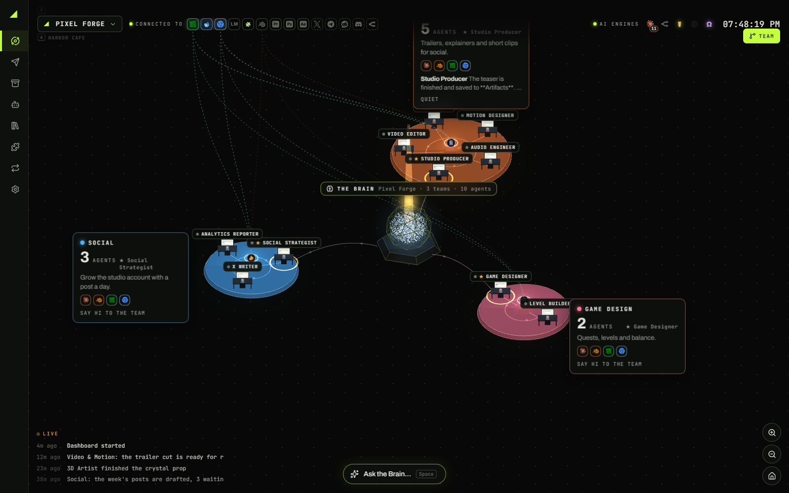
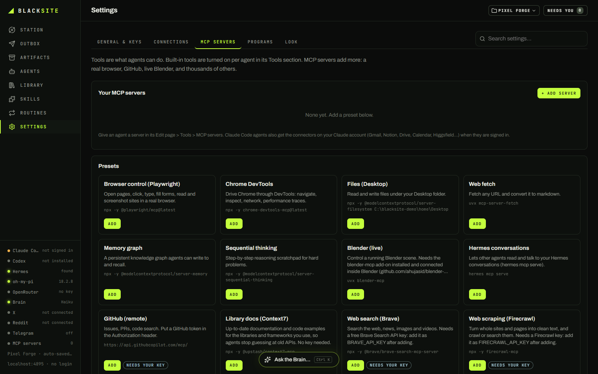
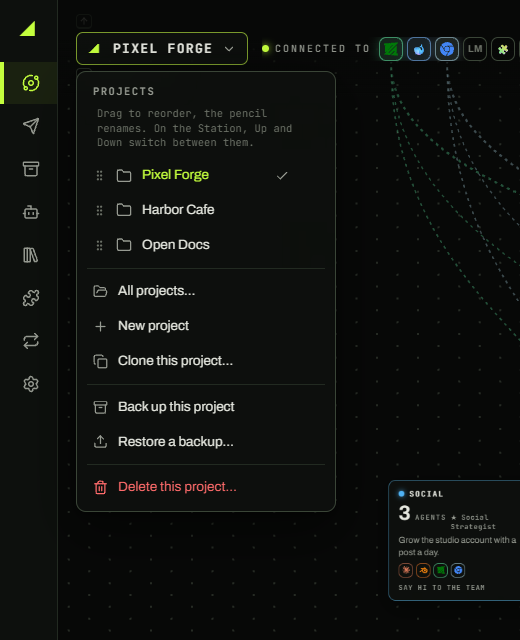

# Athena Agents


**Run AI agents and teams from one local workspace.** Give each agent a role, a model and the tools it needs. Talk to them directly, let them work together, and keep their work with the project it belongs to.

<p align="center">
  
  <br><sub>The Brain setting up an art team for a game project, Rose &amp; Blade, while its agents get to work.</sub>
</p>

<p align="center">
  
  
  
  
  
</p>

Athena Agents is a local-first **AI agent dashboard**: build teams of agents, give each one its own model, tools, skills and memory, and watch them work on a live 3D map. It works with **Claude Code, OpenAI Codex, Hermes, pi, oh-my-pi, OpenClaw, Ollama, LM Studio** and any **OpenAI-compatible API**, and connects to programs and services through the **Model Context Protocol (MCP)**: browsers, Blender, Maya, Houdini, Substance 3D Painter, ComfyUI, ffmpeg, FreeCAD, Rhino, OpenSCAD, 3D printers, Unity, Unreal Engine, Godot, GitHub, Notion, Linear and more.

Aegean blue (`#18688e`) is the default accent, with a lighter matching tone in dark mode. The Athena helmet marks the app, with Cinzel lettering on the sidebar and About page wordmarks and the Station's clock, served locally so it works offline. Brand images are in [`public/brand`](public/brand).

The dashboard runs at **http://localhost:4800**, with no dashboard account or login. Its server and saved state stay on your computer. **Local does not mean offline:** hosted models and connected services receive the requests you send them. You can also use local models through LM Studio or Ollama.

[What you can do](#what-you-can-do) · [Screenshots](#screenshots) · [Get started](#get-started) · [Connect a model](#connect-a-model) · [Your first project](#your-first-project) · [Where things are](#where-things-are) · [Approvals and safety](#approvals-and-safety) · [Save and restore](#save-and-restore) · [Development](#development) · [Detailed guide](docs/guide.md)

## What you can do

- **Build a team for a job.** Describe the outcome to the Brain, or choose agents from the Agent library. Each agent keeps its own instructions, knowledge, memory, model, skills and tools.
- **Track the work together.** Open **Tasks** in an agent, team or Brain chat. Keep the steps, owners, status and prerequisites in one saved project list. The Brain shows all project tasks, with filters for each team and agent.
- **Mix models.** Use Claude Code, Codex, Hermes, pi, oh-my-pi, OpenClaw or OpenAI-compatible APIs, including local model servers. Team members do not need to use the same engine.
- **Work with your files and programs.** Give agents a project folder, attach reference files, and connect tools for programs such as Blender, Maya, Houdini, Substance 3D, ComfyUI, ffmpeg, HandBrake, ImageMagick, OpenSCAD, PrusaSlicer and NVIDIA's texture tools, and let them pull free textures, HDRIs and models from Poly Haven and ambientCG. The Programs page also finds Adobe apps, free creative programs (GIMP, Krita, Inkscape, Audacity and more), video editors (DaVinci Resolve, CapCut, Kdenlive and more), CAD programs and slicers. Add more tools through MCP servers.
- **Keep useful instructions.** Write skills in plain words, share them across agents and teams, and turn repeated work into routines you can run by hand or on a schedule.
- **Review work before it goes out.** Handle permission requests in **Needs you**, answer agents' questions and review X and Reddit drafts in the **Outbox**, and find saved results in **Artifacts**. If an API-model tool may have made changes before failing, its outcome check stays in **Needs you** after the run ends.
- **Agents ask you when they need you.** When an agent has to choose, needs something only you can give, or is stuck, its question goes to the **Outbox** and the **Needs you** drawer, with the choices as buttons and a box to answer in your own words. You can also answer right in its chat while it waits.

## Screenshots

The screenshots below use made-up demo data.

### The Station: your agents, teams and tools on one live map

Each team is a pod with its agents at their desks. The Brain sits in the middle and sets up teams, skills and routines when you ask. Lines run from the programs and services at the top to the agents that use them, and light up when an agent makes a call.

The Station's activity feed shows **Live** in green while live updates are connected, and **Reconnecting…** if the connection drops.



### A voxel world your agents build

Turn on **Settings › Appearance › Station look › Voxel world** (or ask the Brain to) and the Station gets a sky, a sun with soft shadows and glowing lights: a voxel diorama around your agents. Ask the Brain for a world (*"make the Station a floating cherry garden at dusk"*) and it writes a **WORLD.md** with the world's theme, look and characters, then builds. Nothing comes ready-made: the Brain and agents with the **Voxel world** tools build everything, near their own team. They make small things once as **prefabs** (a person, a tree, a lamp, a taxi) and place hundreds of copies, turned and recoloured, so a scene can be a busy street or a river full of boats. They set the time of day and the weather, and add lights and drifting petals, snow, fireflies or smoke. Agents can take any form in the world, a person, an animal, a tree or a lamp, with animations they design themselves for working, idle and needing you, and a builder can take an agent, a platform or the Brain off the map when the picture is better without it. Builders can also write small programs for repetitive or procedural work (rows of houses, branching trees, terrain from noise), run sealed off from your computer. They look at what they built with a picture tool and fix it, bring in MagicaVoxel models, and save the world as a 3D model (.glb) or pictures to Artifacts. They keep WORLD.md up to date, and can share good prefabs with every project through the prefab library. Every build can be undone, and changing what someone else built asks you first.

### Team chats where agents work together

Everyone sees the whole conversation. Agents hand work to each other with @mentions, and the files they make show up in the chat: images, video, audio and 3D models you can turn with the mouse. Teams talk to each other too: write **#Team Name** and the message goes to that team's chat, and its answer comes back once that team is done.

When nobody is named, the team uses the reply, needed tools, lead or best fit to choose who answers. If none matches, it asks the first free member, or queues the message when everyone is busy, and says who it chose in the chat. Members assigned the same message are told about each other. Shared messages enter each member's conversation in full. API-model agents use Eve for their tool loop, saved sessions and native compaction. When memory fills, each engine manages its own active context; the saved originals remain available. Agents can search their own past chats and their teams' conversations, then read the original messages, including text left out by compaction.

Delegated API-model tasks that resume after an app restart keep the same handle, so the calling agent can collect their final answer.

Chats open as tabs in floating windows. Drag a tab out onto the map to give it a window of its own, drag it onto another window's tabs to move it there, or drag a window by its title bar onto another's tabs to join the two. **Ctrl+↓** (**⌘↓** on macOS) minimizes the window on top, and **Ctrl+↑** (**⌘↑**) brings back the one you minimized last. The **Arrange** button in a window's title bar snaps it to the left or right half, puts the windows side by side, gives every tab a window of its own, or combines them all into one; **Ctrl+Alt** (**Ctrl+⌥**) with **←** / **→** / **↑** / **↓** does the same from the keyboard. **Ctrl+F** (**⌘F**) searches the chat you are in (the Brain's, an agent's or a team's) or a Markdown file you are reading: it lights up every match, shows how many there are, and **Enter** / **Shift+Enter** go to the next or previous one. It reads the whole chat, even the old messages that are not drawn on screen. Very large Markdown files (up to 200 MB) open quickly too, because only the part you are reading is drawn.


### Artifacts: what the teams finished

Written results, files and folders that agents saved, each with a preview, who made it, which team it was for and when, and a search box for when there are many.


### MCP servers in one click

Add servers from a list (search it by name or what it does), or ask the Brain to do it. **Suggested for this PC** at the top lists the ones for programs you have installed (Blender, GIMP, OBS…) plus a few that help most agents. Nothing is added until you click Add or say yes to the Brain. Most services' own servers need no key: a browser window opens to sign in the first time they run.

- **Work:** a browser, GitHub, Notion, Linear, Jira and Confluence, ClickUp, monday.com, Todoist, Airtable, Miro, Dropbox, Calendly, Fireflies, Gamma, Intercom, OOMOL (your connected apps and its hosted AI tools), Composio (hundreds of apps through one account), web search.
- **Building software:** GitLab, Sentry, Vercel, Netlify, Cloudflare, Railway, Supabase, Neon, CircleCI, Buildkite, Postman, Semgrep, Datadog, Grafana, Hugging Face.
- **Data, sales and marketing:** Amplitude, Mixpanel, Algolia, MotherDuck, Attio, Close, Klaviyo, Webflow, WordPress.com, market data.
- **Docs and travel, no key:** any GitHub repo explained (DeepWiki), Microsoft and AWS docs, Wolfram|Alpha, Kiwi.com flights, trivago hotels.
- **3D and games:** Blender, Maya, Houdini, Substance 3D Painter, Unity, Unreal Engine, Godot, Tripo, Meshy, Sketchfab.
- **Images, design and stock:** Canva, Freepik, Unsplash, Pixabay, Pexels, Google Fonts, GIMP, Krita, Inkscape, Topaz (AI upscaling).
- **Audio and video:** ElevenLabs, Audacity, REAPER, MuseScore, OBS.
- **CAD and 3D printing:** FreeCAD, Rhino, OpenSCAD, your 3D printer.

**More than one account of a service.** Click **Add another** on a preset you already have (say a work and a personal OOMOL or Composio). Give each one a label ("Work", "Personal") and say what it is for. An agent or team can have one account or several: it picks by what each is for, asks you when it's unclear, and approvals say which account a step goes through. While an agent works for a team, the team's account of a service takes the place of the agent's own.



### Projects as floors



Each project has its own agents, teams, chats and Brain folder. Drag projects into the order you like, and press Up and Down on the Station to move between them. You can rename, clone or delete a project (a delete first makes a backup and checks it).

<br clear="right">

## Get started

### Desktop app

Install **Athena Agents** like any other app; it needs no Bun and no terminal. Installers are on this repository's **Releases** page:

| System | Download |
|---|---|
| Windows (x64 or Arm) | `…_x64-setup.exe` or `…_arm64-setup.exe` (an `.msi` is there for x64 too) |
| macOS (Apple silicon or Intel) | `…_aarch64.dmg` or `…_x64.dmg` |
| Linux (x64 or Arm) | `.deb` or `.rpm`, or an `.AppImage` on x64 |

The installers are not signed yet: on Windows choose **More info → Run anyway**; on macOS, Control-click the app in Finder and choose **Open**. The app keeps its own data folder and uses port 14800, so it can run next to the browser version on 4800. Closing the window keeps it running in the tray; quit from the tray icon. It checks for new versions and asks before installing one. See [desktop app notes](docs/guide.md#desktop-app-notes).

### From the source code

You need [Bun](https://bun.sh) **1.4 or newer**, and a model to run your agents (see [Connect a model](#connect-a-model)). In this repository's folder:

```sh
bun install
bun run start        # build the page, start the server, open http://localhost:4800
```

Keep the terminal running; **Ctrl+C** stops the server.

```sh
bun server/index.ts --port 4900 --no-open   # choose a port, do not open a browser
bun run dev                                 # rebuild and restart on every change
```

On Windows you can also double-click [`start.cmd`](start.cmd), and `powershell -ExecutionPolicy Bypass -File install-shortcut.ps1` adds a desktop shortcut (`-Autostart` also starts it at sign-in, `-Remove` removes both).

### Connect a model

Open **Settings → General & keys**. You only need to set up the engines you want to use.

| Engine | What you need |
|---|---|
| **Claude Code** | The `claude` CLI. Use your Claude login, an Anthropic key or OpenRouter. |
| **API model** | An OpenRouter or Venice key, a running LM Studio or Ollama server, or another OpenAI-compatible endpoint. Configure local endpoints under **Local and custom models**. |
| **Hermes** | An installed Hermes setup with a profile to use. |
| **OpenAI Codex** | The `codex` CLI and your ChatGPT login. Settings offers installation and sign-in; installation uses npm. |
| **pi** | The `pi` coding agent (`npm install -g @earendil-works/pi-coding-agent`), signed in to a model provider (`/login` in pi, or a key such as `ANTHROPIC_API_KEY`). |
| **oh-my-pi** | The `omp` CLI (`bun install -g @oh-my-pi/pi-coding-agent`), signed in with `/login` in omp. |
| **OpenClaw** | The `openclaw` CLI, set up with `openclaw onboard`. Pick which of your OpenClaw agents answers in the agent's settings. |

Choose **The Brain's model** in the same settings page. The Brain is the project-wide assistant: it answers questions, builds agents and teams, writes the project brief, manages skills, routines and MCP servers, switches agents' models, stops work, and hands work to the right people.

The chat model picker and Station’s AI engines strip show only engines that are set up: saved API keys, installed local engines and, where checked, an active sign-in. Add or change setup in **Settings**.

For **Venice**, save an inference key under **API keys** and press **Test** to check access and balances without generating an answer. Choose a model from the **Venice** tab in a chat's model picker, or select **API model → Venice** in an agent's editor. The Brain can use Venice too. **Defaults for new agents → Venice model** sets its own fallback model; save settings after choosing it. Tools, image attachments and effort depend on the selected model. See [Venice setup and costs](docs/guide.md#venice-models).

Claude Code and Codex receive dashboard tools through an MCP bridge; API-model agents call them directly. pi and oh-my-pi get them on their first run; Hermes needs a one-time **Give Hermes the dashboard tools** click under **Settings → MCP servers**. See [Giving engine CLIs the dashboard tools](docs/guide.md#giving-engine-clis-the-dashboard-tools).

## Your first project

1. **Choose a folder.** From the project picker, select **New project**. Start in a new folder, use an existing one, or clone a GitHub repo (with your `gh` login).
2. **Ask the Brain for a small, concrete job.** Open **Ask the Brain**, press **Ctrl+K** (**⌘K** on macOS), or press **Space** on the Station when you are not typing: *“Build a small team to review this project's docs. Have one agent find confusing setup steps and another suggest clearer wording. Do not change files yet.”*
3. **Review the agents and their access** — models, instructions, tools, work folders — or add a ready-made agent from the **Agent library**. In an agent's editor, choose its emoji or type your own.
4. **Follow the work.** Click a team or agent on the Station to open its panel and chat.
5. **Handle anything waiting on you:** permissions in **Needs you**, agents' questions and outgoing drafts in **Outbox**, saved results in **Artifacts**.

Projects keep separate agents, teams and chats. The project name at the top left switches projects, creates another one, or makes a backup.

## Where things are

| Place | Use it for |
|---|---|
| **Station** | The live 3D view of the project: the Brain in the middle, agents grouped into team pods, each with a symbol in the middle (an emoji, or your own picture or 3D model, set in the team's Setup tab). Click to open panels and chats. Projects are like floors: the project menu (top left) lists them in an order you can drag to change, and the Up and Down keys on the Station switch between them. From the menu or the All projects screen you can rename a project, clone it, or delete it (a delete first makes a backup and checks it; the project's own folder is never touched). Click the Brain to give the project a logo or a 3D model (`.glb`, `.obj`, `.stl`, `.ply`, `.fbx`, up to 15 MB) that turns inside its globe, or a background picture behind the map (in the classic look and the voxel look, where it takes the sky's place). You can also ask the Brain to set or remove the background, or to make it or the map's dots fainter. |
| **Brain chat** | Project-wide questions, building teams, changing skills, routines and MCP servers, switching models, stopping work and handing work on. On every page. |
| **Agents** | Instructions, knowledge, MEMORY.md, model and effort, autonomy, tools, MCP servers, skills and workspace. Above the list: how many agents the project has (also next to **Agents** in the sidebar), how many are working, and charts of their categories (Agent library division, or your own, made by the Brain…) and their models; click a category or model to show only those agents. On the Station, an AI engine at the top right that is set up and used by agents opens its agents here. |
| **Agent library** | **Athena** agents (made for this dashboard and its tools: a Coordinator, X Writer, Image Maker, World Builder…), The Agency's 270+ specialists (they come with the dashboard), Hermes profiles, Claude Code subagents and your presets. |
| **Skills** | Reusable instructions, their assignments, earlier versions and recently deleted ones. |
| **Routines** | Repeatable jobs, their schedules and the results of each run. **Run now** uses the routine's saved instructions. One switch controls manual and scheduled runs; daily schedules can have several times. |
| **Outbox** | Questions from agents (click a choice or write an answer), and X and Reddit drafts waiting to be approved, edited or rejected. |
| **Artifacts** | Written results, files and folders that agents have saved, each with a preview (images, video, audio, 3D models you can turn) and a search box. Chats show the same previews for files agents mention; in the desktop app any of them opens in its own program. |
| **Settings** | Engines and keys, accounts and connections, chat gateways, MCP servers, programs, and the look: UI scale, colour scheme (System, Light or Dark), accent colour (each with a light and a dark tone), motion, the Station's look (the classic map, pale on a light system and dark on a dark one, or the voxel world's light: sky, sun and soft shadows, glow) and the open project's background picture, with sliders for how strongly the picture and the map's dots show, the font chats are written in (the page's own font by default, a serif, a terminal font like Claude Code, your system font like ChatGPT, Google Sans like Gemini, Roboto like Android, or San Francisco like iPhone), how hard the Station map works (**Smooth**, **Balanced** or **Battery saver**), and whether the bottom of the sidebar shows what's set up or your Claude and Codex usage limits (point at Codex to see its free limit resets and a **Reset now** button; the **Status / Limits** switch there does the same). **About** shows the version, the GitHub link with a star button, and this PC's address and data folder; the version and a Star link are also at the bottom of the sidebar. |

**Esc** takes you back to the Station from any other page. What is open closes first — a dialog, a dropdown, the Brain chat, a chat's find box — and a field you are typing in just loses the cursor. On the Station itself there is nowhere to go back to, so **Esc** opens the menu sidebar, and **Esc** again closes it.

In any agent, team or Brain chat, **/** lists the commands (`/queue`, `/stop`, `/resume`, `/resend`, `/loop`, `/goal`, `/compact`, `/clear`), **@** picks another agent, and **#** in a team chat picks another team. What each one does, and how files and long chats are handled: [Chats and files](docs/guide.md#chats-and-files).

Agent and team queues survive a restart. Unfinished work pauses for you to check; use `/resume`
or send a message to continue. Teams keep their assignments and read marks, and reuse saved results
when a run finished before the restart. Delegated tasks keep their handles and saved answers for
six hours, including across restarts.

**Assigned work keeps going.** The Brain checks agent and team results after each turn and follows up on missing work automatically. No `/goal` command is needed. It keeps going while work advances, waits for delegated work, and stops when the result is delivered or your action is needed. Blockers and repeated lack of progress appear in **Needs you** with a question you can answer to continue. **Stop** cancels continuation; changing the project on screen leaves work in its own project. Completion checks use the Brain's configured model.

**Tasks stay with the work.** Agents, teams and the Brain share `TaskCreate`, `TaskGet`, `TaskList` and `TaskUpdate`. They can create or update several tasks in one call, with a result for each item. Tasks hold the requirements, owner and prerequisites; another agent cannot take work already claimed by someone else. The chat's **Tasks** panel lets you add, edit, search and remove them. **Clear tasks** removes all open tasks in the selected list after confirmation and keeps completed tasks. A task records a step; ask in the chat to start the work. Tasks are included in project saves and backups. See [Tasks](docs/guide.md#tasks).

## Approvals and safety

| Autonomy | When dashboard tools ask you first |
|---|---|
| **Ask first** | For low- and high-risk actions. Tools that do nothing risky never ask. |
| **Auto** (default) | For high-risk actions: shell commands, scripts, sending messages. |
| **Full** | Never; tool approvals are skipped. Use only when you trust the agent and its access. |

- **The Brain approves** is on by default: it allows routine, reversible work and sends risky or unclear requests to **Needs you** with a reason. That is a model's judgment, not a hard safety guarantee.
- **Agents can ask for tools.** An agent that needs a set of tools it doesn't have (Files, Browser, Blender…) asks for it. The Brain gives it when the task needs it and sends the rest to **Needs you**. Shell and posting or messaging always come to you. An agent keeps the tools it's given; you can take them away in its settings.
- The server listens on **127.0.0.1** only, and there is **no dashboard login**: anyone who can reach the running service may be able to use it. Never expose it through a public tunnel or reverse proxy.
- Keys and account tokens stay server-side, in `data/secrets.json` and `data/accounts.json`. They are never sent to the browser or included in project exports.
- Autonomy is not an operating-system sandbox: built-in file tools respect the allowed roots, but shell commands and outside tools act with the access of the account running them.

More: [Approvals and safety](docs/guide.md#approvals-and-safety).

## Save and restore

- **`data/`** (git-ignored) holds projects, agents, teams, chats, knowledge, MEMORY.md files, skills, presets, settings, the Outbox and activity. The desktop app uses its own data folder.
- Each project folder also gets a **`.dashboard`** copy of its agents, teams, routines, chats, memories and the skills it uses, so opening that folder as a project brings the state back. These copies hold no keys or account tokens, but they do hold what you put in chats, knowledge files, memories and skills.
- **Project menu → Back up this project** writes a `.dashbackup` file under `Blacksite Backups` in your home folder; **New project → From backup** restores it as a new project, with schedules paused. Neither includes your working files.
- **History** on a skill, agent, team or MEMORY.md compares earlier versions (the last 50 per item) and restores them.

More: [Save and restore](docs/guide.md#save-and-restore).

## Troubleshooting

- **`bun` is not found:** install it from [bun.sh](https://bun.sh), then open a new terminal.
- **The page does not open:** visit http://localhost:4800 directly (or the port you chose) and check the server terminal for errors.
- **Browser changes do not show:** run `bun run build` and reload, or use `bun run dev` while editing.
- **An agent cannot run:** check its engine in Settings, its login or API key, and whether a local model server is running.

More: [Troubleshooting](docs/guide.md#troubleshooting).

## Development

Chat gateways are in development. Experimental Telegram and Slack instances can pass allowed text and attached files
to the Brain, a team or an agent and send final text replies. Files explicitly selected through the local API
or explicitly handed in by a gateway agent through its approval policy can be sent as Telegram documents or Slack files.
Set up Telegram or Slack instances under **Settings → Gateways**, choose their project, destination and sender rules,
then enable them. Open an instance's **Inbox** to review delivery, retry unconfirmed parts, skip files or select
specific files to send. Uncertain retries ask you to check the messaging app first. Artifacts and tool images are not attached automatically.
**Check saved work** can recover a verified completed reply or resume tracking its original operation without starting another run.
Telegram albums wait in the inbox for **Group album and start**. Check Telegram for all parts first;
one assignment includes every saved file and caption. Later parts or edits hold the work for review.
The sidebar's **Status** panel links gateway warnings to the relevant inbox or instance setup.
Completed inbox receipts can be removed after confirmation. Native chats, files, replay protection and byte accounting stay intact.
Delegated files stay tied to their source run and workspace; revoked access holds delivery for review.
Slow requests show a short working notice; approvals stay in Athena. Uncertain sends need review before retrying.
`bun run gateways:smoke` checks the SDK with
a fake local Telegram service and throwaway data; it uses no accounts or keys. See the
[gateway plan](docs/internal/plans/CHAT_GATEWAYS_2026-11-01.md) for what is finished and what remains.
`bun run gateways:slack-smoke` checks Slack Socket Mode, private files and threaded replies against
a local service. Slack needs a workspace ID, separate bot/app tokens and explicit conversation scopes.
Its sender list is optional; empty allows local workspace users within those scopes. Real-account checks remain pending.
`bun run gateways:discord-smoke` checks Discord identities, scopes, permissions and restart recovery
against local REST and WebSocket fixtures, including private downloads and selected file replies.
It uses no real account; Discord remains unavailable in Settings while setup and supervised workers
are being finished.

The Eve runtime replacement is being developed separately from the current API engine. Building
the runtime uses Bun 1.4 or newer. `bun run eve:build` builds it and `bun run eve:smoke` checks
its private HTTP API, tool bridge, idle restart and file inputs with a fake model and throwaway data.
`bun run eve:integration` also checks Athena's real tool bridge, saved session ownership, events,
and restart during file, tool-access, voxel-ownership, appearance and Outbox approvals.
It also checks that a native run stays busy through worker restart and records its answer and
completion once, without another user input.
These checks do not use your accounts or API keys. Desktop builds use the existing bundled Bun runtime.

Bun runs the TypeScript server and bundles the browser app. The code is strict TypeScript; server and shared modules must also work under Node, because Vitest imports them there. CI uses **Bun 1.4.4** and **Node 24**, and checks Windows and Linux.

```sh
bun run dev          # watch browser and server changes
bun run check        # typecheck both sides, then run tests
bun run build        # build the browser bundle
bun run typecheck
bun run test
bunx vitest run tests/server/skills.test.ts
bun run icons        # regenerate icons after editing scripts/build-icons.ts
```

The desktop app needs [Rust](https://rustup.rs) and, on Linux, [Tauri's system libraries](https://tauri.app/start/prerequisites/):

```sh
bun run desktop:dev     # build and open the app
bun run desktop:build   # make installers in src-tauri/target/release/bundle
```

[`docs/desktop.md`](docs/desktop.md) explains how the app works and how releases are made.

| Path | Contents |
|---|---|
| [`server/`](server/) | HTTP and WebSocket server, agent engines, tools, the Brain and JSON storage. |
| [`web/`](web/) | Browser app: React on Base UI, with the page shell and the Station's map in plain DOM; three.js for the Station. |
| [`shared/`](shared/) | Shared types and logic. Data shapes start in `shared/types.ts`. |
| [`public/`](public/) | HTML and styles. `public/dist/` is generated build output; do not edit it. |
| [`tests/`](tests/) | Vitest server and browser tests, on temporary data and home folders. |
| [`scripts/`](scripts/) | Build and development scripts, icon generation and the agent CLI helper. |
| [`src-tauri/`](src-tauri/) | The desktop app (Tauri): a window that starts the bundled server. |

To send a message to an existing agent from a terminal while the server is running:

```sh
bun scripts/try-agent.ts <agentId> "your message" --port 4800
```

`--approve` automatically approves **all pending permission requests**; use it only in an isolated test instance.

Run `bun run check` and `bun run build` before submitting changes. See [`AGENTS.md`](AGENTS.md) for code conventions and security boundaries.

## License

Athena Agents is yours to use under either the [MIT license](LICENSE-MIT) or the [Apache License 2.0](LICENSE-APACHE), whichever you prefer. Unless you say otherwise, anything you contribute is offered under the same two licenses.

Some bundled pieces keep their own licenses: the skills in `skills/` and The Agency's agents in `library/agency-agents/` (each folder's `README.md` says where it's from), the Crafting App icons in `public/craft-icons/` (MIT OR Apache-2.0), Lucide icons (ISC) and Simple Icons logos (CC0). Brand names and logos stay their owners' trademarks.

## Credits

Inspired by [agent-office](https://github.com/AgentSystemLabs/agent-office). The Agent library includes specialists from [agency-agents](https://github.com/msitarzewski/agency-agents). The Crafting App icons come from each app's repository (MIT OR Apache-2.0), see `public/craft-icons/README.md`.
